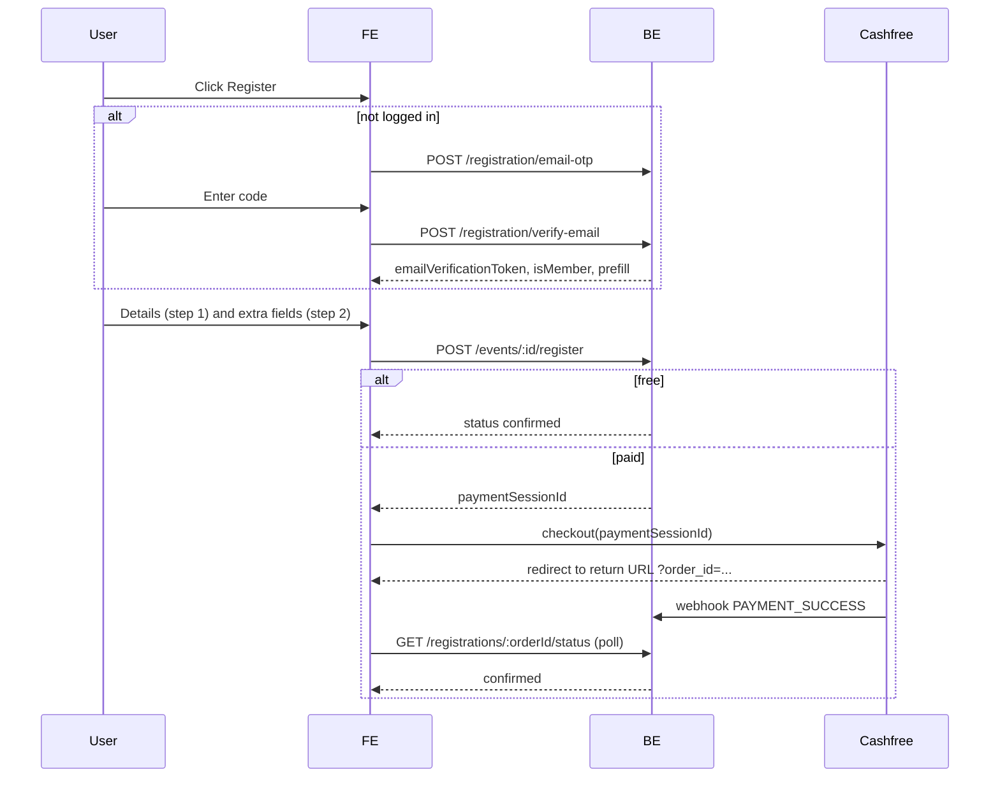

# Event registration: user flow and FE integration guide

Backend base URL: `/api/v1`. All responses use the envelope `{ success, message, data }`.
Send `credentials: 'include'` on every call so a logged-in member's cookie session is picked up.

## 1. What changed (summary for FE)

| Area | Before | Now |
|---|---|---|
| Who can register | Logged-in members only | Members, and non-members on **open** events |
| Event types | One kind | `accessType`: `open` or `members_only` |
| Registration | One click, `POST /events/:id/register` | 3-step form: details + email verification, extra fields, payment |
| Pricing | None | Optional paid events: one member price, one non-member price (whole INR) |
| Form | Fixed | Admin adds custom fields at event creation |
| Capacity | `capacity` field | **Removed.** Anyone who registers is accepted. |
| Cancel | n/a | Users **cannot** cancel. Only admins refund. |
| `registeredCount` | Derived from members array | Count of **confirmed** registrations |
| Delete event | Always allowed | Never for past events; for upcoming paid events only after all refunds succeed |

Breaking API changes the FE must handle:
- `POST /events/:id/register` no longer requires login, and its response is now `{ registration, payment }` (was `{ event }`).
- `capacity` is gone from event create/update/responses. Remove it from forms and UI.
- `PATCH /admin/events/:id` **rejects** `accessType`, `pricing` and `registrationFields` with 422. Do not send them on edit, even unchanged.
- `GET /admin/events/:id/attendees` now returns registrations (new shape, see 6.3).

## 2. Event data (public and admin responses)

New fields on every event object (`GET /events`, `GET /events/me`, `GET /kpi`, admin create/update):

```json
{
  "accessType": "open",
  "pricing": { "isPaid": true, "memberPrice": 300, "nonMemberPrice": 500, "currency": "INR" },
  "registrationFields": [
    { "key": "hospital_name", "label": "Hospital name", "type": "text", "required": true, "placeholder": "e.g. Apollo" }
  ],
  "registeredCount": 42,
  "registrationsClosed": false
}
```

- `pricing.isPaid = false` means free; prices are `null`.
- `members_only` events have `nonMemberPrice: null`.
- `registrationFields` holds only the **extra** fields. The basic fields (name, email, phone, ISAR ID for members) are always present and are not listed.
- Field `type` is one of `text`, `textarea`, `number`, `email`, `phone`. Use `key` as the answer key when submitting.
- `registrationsClosed` may be absent on old events (treat as false). When true, show "Registration closed".
- `registered` (boolean) still exists on `GET /events/me` and `GET /kpi` for a logged-in member.

Price to show the user: if the user is a member, `memberPrice`; otherwise `nonMemberPrice`. Free events show "Free".

## 3. Attendee flow

### 3.1 Entry and eligibility (client side)
1. Show the **Register** button unless one of these applies:
   - event date is before today (server rejects with 400: registration closed),
   - `registrationsClosed` is true,
   - `registered` is true (for logged-in members).
2. Badge the event "Members only" when `accessType === 'members_only'`. If the user is not a logged-in member, offer login, or the email check below (a verified member email also works).
3. Open the registration form (3 steps).

### 3.2 Step 1: personal details and email verification

**Logged-in member (cookie session):** skip verification.
- Prefill name, email, ISAR ID (read-only) and phone (editable) from the member profile you already load.
- The server ignores any name, email or ISAR ID you send for a logged-in member and uses the member record. Phone comes from the form, or from the profile if omitted. If the profile has no valid phone, the form must collect one.

**Everyone else (non-member, or member not logged in):**
1. User enters email, then call:
   `POST /events/:id/registration/email-otp` with `{ "email": "a@b.com" }`
   - 200: code emailed (valid 10 min).
   - 403: the event is members-only and this email is not a member. Show "This event is open to KISAR members only."
   - 429: too many requests (5 per 15 min per IP). 400: invalid email or event closed. 502: email failed to send.
2. User enters the 6-digit code, then call:
   `POST /events/:id/registration/verify-email` with `{ "email": "a@b.com", "otp": "123456" }`
   - 200 `data`:
     ```json
     { "emailVerificationToken": "<jwt>", "isMember": true,
       "prefill": { "name": "...", "phone": "...", "isarMemberId": "..." } }
     ```
   - `prefill` is `null` when `isMember` is false.
   - 400: wrong/expired code. 429: more than 5 wrong attempts, so request a new code.
3. Keep `emailVerificationToken` in memory (valid **30 minutes**, tied to that email and event). Lock the email field after verification.
4. If `isMember` is true: show member price, prefill name/phone, show ISAR ID read-only. The user gets member treatment without a separate login.
5. If `isMember` is false: user fills name and phone manually. No ISAR ID field.

Collect for step 1: `name` (non-members), `phone` (10-digit Indian mobile; `+91` and spaces are accepted).

### 3.3 Step 2: additional details
Render `event.registrationFields` in order, using `type` for the input and `required` for validation:

| type | input | server rule |
|---|---|---|
| `text` | single line | up to 200 chars |
| `textarea` | multi line | up to 2000 chars |
| `number` | number | must be numeric |
| `email` | email | valid email |
| `phone` | tel | 10-digit Indian mobile |

If there are no extra fields, skip this step. Nothing is sent to the server yet.

### 3.4 Step 3: review and pay

Show a summary (name, email, answers, amount). Then call:

`POST /events/:id/register`
```json
{
  "name": "Asha Rao",
  "email": "asha@example.com",
  "phone": "9876543210",
  "answers": { "hospital_name": "Apollo", "years_of_practice": 8 },
  "emailVerificationToken": "<from step 1, omit for a logged-in member>"
}
```

Response `201` `data`:
```json
{
  "registration": { "id": "...", "eventId": "...", "eventTitle": "...", "status": "confirmed", "amount": 0,
                    "currency": "INR", "isMember": true, "name": "...", "email": "...", "phone": "..." },
  "payment": null
}
```
- **Free event** (`payment: null`, `status: "confirmed"`): done. Show the success screen. A confirmation email is sent.
- **Paid event** (`status: "pending_payment"`):
  ```json
  "payment": { "orderId": "KISAR-<id>-1", "paymentSessionId": "session_...", "environment": "sandbox" }
  ```
  Open Cashfree checkout with `paymentSessionId`. Use the Cashfree JS SDK (`@cashfreepayments/cashfree-js`):
  ```js
  const cashfree = await load({ mode: payment.environment === 'production' ? 'production' : 'sandbox' });
  cashfree.checkout({ paymentSessionId: payment.paymentSessionId, redirectTarget: '_self' });
  ```
  The amount is decided by the server; never send a price.

Validation failures return `422` with `data.errors: string[]` (show them against the fields).

### 3.5 After payment: the return page
The return URL is **`/events/registration/return`** (prod: `https://www.kisar.org.in/events/registration/return`, dev: `http://localhost:5173/events/registration/return`). Cashfree sends the user there with `?order_id=KISAR-...` whether they paid, were declined, or pressed back, so this page must work out which one it was.

Call `GET /registrations/:orderId/status` (public, no auth). `data`:
```json
{ "status": "pending_payment", "paymentState": "failed", "eventId": "...", "eventTitle": "...", "amount": 500 }
```

`status` is the registration state; `paymentState` is what the gateway says about the payment attempts. Drive the page from `paymentState`:

| `paymentState` | Meaning | UI | Poll? |
|---|---|---|---|
| `success` | Paid. If `status` is still `pending_payment`, confirmation is a moment away. | If `status === 'confirmed'`: success screen. Otherwise "Payment received, confirming your seat..." | Yes, until `status === 'confirmed'` (about 60 s max, then "You'll get an email once it's done. Don't pay again.") |
| `processing` | Payment submitted but not final (bank still deciding, e.g. UPI pending) | "Your payment is being processed..." | Yes |
| `failed` | Card/UPI declined or errored | "Your payment didn't go through." + **Try again** | No |
| `cancelled` | User backed out or closed checkout | "You cancelled the payment." + **Try again** | No |
| `not_attempted` | Never reached a payment attempt | "We haven't received your payment yet." + **Try again** | No (optionally re-check once or twice) |
| `expired` | The payment window (30 min) ended | "This payment session expired." + **Try again** | No |
| `null` | Registration is not awaiting payment (`confirmed`, `refund_pending`, `refunded`, `event_cancelled`) | Use `status` | No |

- **Try again**: send the user back to step 3 and call `POST /events/:id/register` again with the same data. If the old order is still live the server returns the **same** `paymentSessionId`; if it expired or failed terminally it creates a fresh order. Either way the user is never charged twice for one registration.
- `status === 'refund_pending' | 'refunded' | 'event_cancelled'`: the event was cancelled; show "This event was cancelled. Any payment is being refunded."
- The status call reconciles with the gateway directly, so it works even if the webhook is delayed.
- Show neutral copy for `processing`/`success`-but-not-confirmed; never show "failed" copy for those.

### 3.6 Retrying and avoiding double payment
- If the user abandons checkout and submits the form again with the same email, the server **reuses the live payment session** (no second order). Just open checkout with the returned `paymentSessionId` again.
- Disable the Pay button while a request is in flight.
- If the user already paid, the same call returns `registration.status: "confirmed"` and `payment: null`. Go to the success screen.
- If someone is already confirmed for that email, `register` returns `409` ("already registered").

### 3.7 Error handling cheat sheet (`POST /events/:id/register`)

| Status | Meaning | UI |
|---|---|---|
| 201 | Registered, or payment session returned | See 3.4 |
| 400 | Event passed, or registration closed | Show message, hide Register |
| 401 | Email not verified / token expired or mismatched | Send the user back to step 1 |
| 403 | Members-only event and not a member | "Members only" message |
| 404 | Event not found | Not found page |
| 409 | Already registered | "You're already registered" |
| 422 | Validation errors in `data.errors` | Show against fields |
| 502 / 503 | Payment gateway problem | "Payment unavailable, try again shortly" |

## 4. Admin flow

### 4.1 Create event (`POST /admin/events`, multipart)
New form controls:
- **Access**: "Open for all" / "Members only" (`accessType`, required).
- **Paid?** toggle, then price inputs (whole rupees, minimum 1):
  - Open + paid: member price and non-member price (member price cannot exceed non-member price).
  - Members-only + paid: member price only.
- **Registration form builder**: add up to 15 extra fields: label (max 60), type (text/textarea/number/email/phone), required, placeholder (max 100). Show the fixed basic fields (name, email, phone, ISAR ID for members) as non-editable.

Because the request is multipart, send nested values as JSON strings:
```
accessType=open
pricing={"isPaid":true,"memberPrice":300,"nonMemberPrice":500}
registrationFields=[{"label":"Hospital name","type":"text","required":true,"placeholder":"e.g. Apollo"}]
```
Field `key`s are generated by the server from the label; read them from the response.

**Warning to show before submit:** "Access type, pricing and registration form cannot be changed after the event is created. Please review them carefully." (A mistake means deleting and recreating the event.)

Remove the `capacity` input.

### 4.2 Edit event (`PATCH /admin/events/:id`)
Editable: title, type, date, time, location, link, link label, banner, images, highlight.
Show access type, pricing and form fields **read-only**. Never include them in the PATCH body (it returns 422 if present).

### 4.3 Attendees (`GET /admin/events/:id/attendees?page=&limit=&status=`)
`status` is optional, default `confirmed`; other values: `pending_payment`, `refund_pending`, `refunded`, `event_cancelled`.
```json
{ "event": { "id": "...", "title": "...", "registeredCount": 42 },
  "attendees": [{ "id": "...", "name": "...", "email": "...", "phone": "...", "isMember": true,
                  "isarMemberId": "ISAR123", "answers": [{ "key": "hospital_name", "label": "Hospital name", "type": "text", "value": "Apollo" }],
                  "amount": 300, "currency": "INR", "status": "confirmed", "paidAt": "...", "registeredAt": "...",
                  "refund": null, "duplicatePayments": [] }],
  "pagination": { "page": 1, "limit": 20, "totalCount": 42, "totalPages": 3 } }
```
Show a warning on rows with a non-empty `duplicatePayments` (the person paid more than once; refund the extra).

### 4.4 Refund one registration (e.g. duplicate payment)
`POST /admin/registrations/:id/refund` (no body). The person is unregistered and gets an email.
- 200: refund started. 409: nothing refundable. 502: gateway failed (retry later).

### 4.5 Cancel a paid upcoming event, then delete it
1. Admin clicks **Delete**. If the event is **past**, the server refuses (409 "Past events cannot be deleted"); hide or disable Delete for past events.
2. Delete returns `409` with `data.refunds` while paid registrations are unrefunded:
   ```json
   { "notStarted": 12, "pending": 0, "failed": 0, "refunded": 0, "failures": [], "readyToDelete": false }
   ```
   Show "Refund all registered attendees before deleting this event" with a **Refund all** button.
3. **Refund all**: `POST /admin/events/:id/refunds`. This closes registration for the event, cancels unpaid checkouts, starts a refund for every paid registration, and emails each attendee. Returns the same summary shape.
4. Show progress with `GET /admin/events/:id/refunds` (add `?sync=true` to re-check pending refunds with the gateway). Refunds are asynchronous and can take days.
5. If `failed > 0`, show `failures[]` (`registrationId`, `email`, `reason`) and a **Retry** button (call `POST .../refunds` again; it only retries unrefunded ones). A common cause is insufficient gateway balance.
6. When `readyToDelete` is true, **Delete** succeeds. Free registrants are emailed that the event is cancelled. Registration records are kept for audit.

Free upcoming events can be deleted directly.

## 5. Emails the user receives (for FE copy consistency)
- **OTP**: "Your email verification code" (step 1).
- **Registration confirmed**: free and paid events; includes order ID for paid.
- **Refund initiated**: when an event is cancelled or an admin refunds them.
- **Event cancelled**: for free registrants when an event is deleted.

## 6. Flow diagram



## 7. Notes and checklist
- **Return URL**: `/events/registration/return` on the FE origin (prod `https://www.kisar.org.in`, dev `http://localhost:5173`). The BE reads it from `PAYMENT_RETURN_URL`, so tell BE if the production origin differs.
- **Old events**: events created before this change may lack `accessType`/`pricing`/`registrationFields` in the database, but the API **always returns them filled in**: `accessType: "members_only"`, `pricing: { isPaid: false, memberPrice: null, nonMemberPrice: null, currency: "INR" }`, `registrationFields: []`. The BE also enforces members-only for them. No FE special-casing is needed beyond reading these fields normally. `registrationsClosed` may be absent (treat as false).
- **CSP (FE hosted separately, e.g. Netlify)**: use `redirectTarget: '_self'` so checkout is a full-page redirect to Cashfree's hosted page. Then your CSP needs only the SDK script and its API calls: `script-src https://sdk.cashfree.com` and `connect-src https://sandbox.cashfree.com https://api.cashfree.com`. If you ever use the modal/iframe target you would also need `frame-src` for Cashfree's checkout domains. Verify the exact list against Cashfree's current docs when you test in sandbox. The BE's own CSP only matters if the BE also serves a copy of `dist/`.
- Payment env: `payment.environment` is `sandbox` until the BE is switched to production keys.
- Dates: "past" means the event date is before today (server timezone).
- Phone: the server stores the bare 10-digit number.
- FE checklist:
  - [ ] Remove `capacity` everywhere
  - [ ] Add access-type, pricing and form-builder to admin create; read-only on edit; never send them on PATCH
  - [ ] Public registration form: 3 steps with OTP verification
  - [ ] Cashfree checkout (`redirectTarget: '_self'`) and the `/events/registration/return` page driven by `paymentState` (see 3.5)
  - [ ] Handle the new `register` response and error codes
  - [ ] Admin attendees table with answers, payment/refund status, status filter
  - [ ] Refund-all and delete flow, and single-registration refund
  - [ ] Hide Delete for past events
